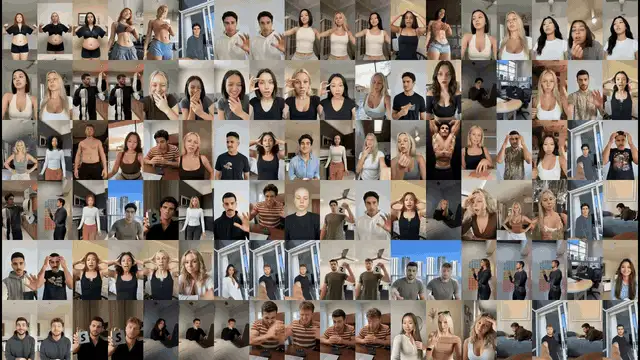

# Ghostfeed Skills: Claude skills for video ads, song ads, UGC videos and TikTok slideshows

Agent skills that let Claude Code, Claude, ChatGPT, Codex and Cursor make finished ads and organic posts: whiteboard, skeleton, Zack D style, claymation, paper, cartoon, cinematic and song ads, UGC videos with one consistent AI creator, and TikTok or Instagram slideshows.

The skills hold the method. The [Ghostfeed MCP server](https://ghostfeed.ai/docs) does the work: it makes the images, clips, songs and slides. **Every skill here needs that connection and a Ghostfeed account** (paid, from $49 a month).

<a href="https://ghostfeed.ai"></a>

## Install

**Claude Code (plugin).** One step installs the skills and connects the Ghostfeed MCP server:

```
/plugin install ghostfeed --marketplace ghostfeed-ai/skills
```

**Any other agent** (Codex, Cursor and the rest of the [skills CLI](https://github.com/vercel-labs/skills) agents):

```bash
npx skills add ghostfeed-ai/skills --skill '*'
```

Then connect the MCP server. One URL, sign in through the browser, no API keys:

```
https://api.ghostfeed.ai/api/v2/mcp
```

Setup for Claude, ChatGPT, Cursor, VS Code, Codex and other MCP clients is in the [quickstart](https://ghostfeed.ai/docs).

## Then ask for an ad

```
Make a 30-second whiteboard ad for my app. Here is the link: ...
```

```
Write a song ad for my protein bar, upbeat indie pop, and cut a music video to it.
```

```
Copy the design of this TikTok slideshow with my own product: <link>
```

## The skills

### Video ads

| Skill | What it makes |
| --- | --- |
| [`ghostfeed-video-ads`](skills/ghostfeed-video-ads/SKILL.md) | A product video ad from a script, a song or a scene idea to one finished video. Start here. |
| [`ghostfeed-ad-style-whiteboard`](skills/ghostfeed-ad-style-whiteboard/SKILL.md) | An explanation drawn live on a whiteboard, by a hand alone or a presenter. |
| [`ghostfeed-ad-style-skeleton`](skills/ghostfeed-ad-style-skeleton/SKILL.md) | A cartoon skeleton acts out a problem that gets worse, then the fix. |
| [`ghostfeed-ad-style-zack-d`](skills/ghostfeed-ad-style-zack-d/SKILL.md) | Zack D style: a 3D explainer where the camera travels inside the problem. |
| [`ghostfeed-ad-style-claymation`](skills/ghostfeed-ad-style-claymation/SKILL.md) | Everything on screen is made of clay. |
| [`ghostfeed-ad-style-paper`](skills/ghostfeed-ad-style-paper/SKILL.md) | People, places and objects made of paper. |
| [`ghostfeed-ad-style-3d-cartoon`](skills/ghostfeed-ad-style-3d-cartoon/SKILL.md) | The look of a family animated feature film. |
| [`ghostfeed-ad-style-2d-cartoon`](skills/ghostfeed-ad-style-2d-cartoon/SKILL.md) | Hand-drawn animation with clean lines. |
| [`ghostfeed-ad-style-realistic`](skills/ghostfeed-ad-style-realistic/SKILL.md) | Real-looking people and places, like live-action footage. |
| [`ghostfeed-ad-style-cinematic`](skills/ghostfeed-ad-style-cinematic/SKILL.md) | A product film with no spoken words. |
| [`ghostfeed-song`](skills/ghostfeed-song/SKILL.md) | An original song for the ad, then a music video cut to its lyrics. |
| [`ghostfeed-ad-copy`](skills/ghostfeed-ad-copy/SKILL.md) | The script, voiceover, lyrics, hook and closing line. |
| [`ghostfeed-ad-characters`](skills/ghostfeed-ad-characters/SKILL.md) | A recurring character, the product and the places, locked as reference pictures. |

### UGC videos and AI creators

| Skill | What it makes |
| --- | --- |
| [`ghostfeed-ugc-reactions`](skills/ghostfeed-ugc-reactions/SKILL.md) | UGC images and videos with your avatar and product: recreate a TikTok or Reel, copy its moves, or make a reaction clip. |
| [`ghostfeed-avatars`](skills/ghostfeed-avatars/SKILL.md) | One consistent AI creator who appears in every video and slideshow. |

### Slideshows and carousels

| Skill | What it makes |
| --- | --- |
| [`ghostfeed-slideshows`](skills/ghostfeed-slideshows/SKILL.md) | TikTok and Instagram photo slideshows. Every slide is HTML and CSS, so the text is exact. |
| [`ghostfeed-slideshow-clone`](skills/ghostfeed-slideshow-clone/SKILL.md) | Copy the design of a post or deck with new pictures and the same or new words. |

`ghostfeed-slideshow-taste`, which both slideshow skills load, is served by the MCP server through `get_skill`.

### Library

| Skill | What it does |
| --- | --- |
| [`ghostfeed-brands`](skills/ghostfeed-brands/SKILL.md) | Make a Brand from a website or a name, and manage its products and images. |
| [`ghostfeed-collections`](skills/ghostfeed-collections/SKILL.md) | Build image collections from Pinterest or your own photos. |

## How the skills and the server fit together

Each skill starts by checking that the Ghostfeed tools are connected. When they are, it reads the current copy of itself from the server with `get_skill`, so an installed skill never goes stale. When they are not, it stops and asks you to connect.

## Limits worth knowing

- One clip is at most 15 seconds. Longer ads are several clips.
- In Claude Code, Codex and Cursor the clips are joined into one finished video. In Claude and ChatGPT chat they come back as separate clips.
- Ghostfeed sends finished posts to your TikTok inbox. It does not schedule them.

## Links

- [Ghostfeed](https://ghostfeed.ai)
- [Documentation and quickstart](https://ghostfeed.ai/docs)
- [Animated ad examples](https://ghostfeed.ai/animated-ads)
- [Agent Skills specification](https://agentskills.io)

## Licence

MIT. See [LICENSE](LICENSE).
